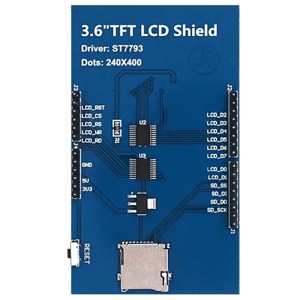
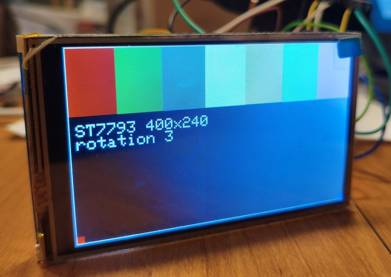
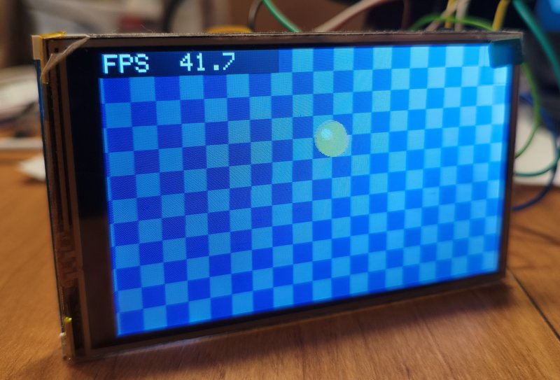

# LovyanGFX – ST7793 driver / sterownik ST7793 (3.6" TFT 240×400)

| Shield | Test on esp32dev / Test na esp32dev | Test on esp32dev / Test na esp32dev |
|---|---|---|
|  |  |  |

Screenshots were taken on an **esp32dev** board (ESP32).
Zrzuty ekranu pochodzą z płytki **esp32dev** (ESP32).

**[English](#english)** · **[Polski](#polski)**

---

<a id="english"></a>

# English

## Description

> This project is a **fork of LovyanGFX**: https://github.com/lovyan03/LovyanGFX

This PlatformIO project adds support for the **Sitronix ST7793** controller to a local copy of the
**LovyanGFX 1.3.0** library (`lib/LovyanGFX`) and contains a test program for the
**"3.6" TFT LCD Shield"**: 240×400 px, **8-bit 8080** parallel interface, SD slot
(unused), 5V/3V3 supply. Controller datasheet: `doc/ST7793.pdf`.

**Supported chips:** ESP32 (esp32dev), ESP32-S3 (esp32-s3-devkitc-1), ESP32-C3 (esp32-c3-devkitm-1).

**Arduino cores:**
- Arduino **3.x** (pioarduino, ESP-IDF 5.x) – envs without a suffix, `platform = espressif32`
  (locally pioarduino 55.03.39 / Arduino 3.3.9),
- Arduino **2.x** (official platform `espressif32@6.13.0`, Arduino 2.0.17 / ESP-IDF 4.4) – envs `*-arduino2`.

**ESP-IDF framework:**
- pure **ESP-IDF 5.5.5** (`framework = espidf`, package `framework-espidf` 3.50505 from pioarduino),
  platform pioarduino 55.03.39 (`platform = espressif32`) – envs `*-idf`.

### Test status

| Chip | Arduino 3.x | Arduino 2.x | Hardware |
|---|---|---|---|
| ESP32 (esp32dev) | builds OK | builds OK | **verified**: writing, reading ID `0x7793`, reading registers and pixels (`dummy_read_pixel = 16`), full-screen animation **41.7 FPS / 8.0 MB/s** at `freq_write = 10 MHz` |
| ESP32-S3 | builds OK | builds OK | not tested |
| ESP32-C3 | builds OK | builds OK | **verified**: correct image (fills, drawing, text). No reading (RD tied to 3V3 - not enough pins) and no FPS measurement, it was tested before the animation was added |

### Pins

The configurations are in `lib/LovyanGFX/src/lgfx_user/LGFX_ESP32*_ST7793.hpp`. `src/main.cpp` picks
the right file automatically (`CONFIG_IDF_TARGET_*`).

**ESP32 (esp32dev)** – bus via I2S; skipped GPIO 6–11 (flash), 34–39 (input only),
0/2/5/12/15 (strapping), 1/3 (UART0), 16/17 (PSRAM on WROVER).

| Shield | GPIO |
|---|---|
| LCD_D0…D7 | 13, 14, 18, 19, 21, 22, 23, 25 |
| LCD_WR | 26 |
| LCD_RS | 27 |
| LCD_RD | 32 |
| LCD_CS | 33 |
| LCD_RST | 4 |

**ESP32-S3 (DevKitC-1)** – skipped 0/3/45/46 (strapping), 19/20 (USB), 26–37 (flash/PSRAM),
43/44 (UART0), 47/48 (VDD_SPI domain / RGB LED).

| Shield | GPIO |
|---|---|
| LCD_D0…D7 | 4…11 |
| LCD_WR | 12 |
| LCD_RS | 13 |
| LCD_RD | 14 |
| LCD_CS | 21 |
| LCD_RST | 1 |

**ESP32-C3 (DevKitM-1)** – skipped 11–17 (flash), 18/19 (USB), 20/21 (UART0/Serial).
Exactly 11 GPIOs remain, which is why CS and RD are hard-wired.

| Shield | GPIO |
|---|---|
| LCD_D0…D7 | 0…7 |
| LCD_WR | 10 |
| LCD_RS | 9 |
| LCD_RST | 8 |
| LCD_CS | **GND** (hard-wired) |
| LCD_RD | **3V3** (hard-wired, write only) |

In all variants: shield **5V/GND** to the board's 5V/GND.

### Hardware notes

- **Buffers U2/U3 on the shield.** The data and control lines go through two 20-pin chips
  (most likely 74xx245-type buffers/level translators). Reading from the LCD works only if they pass
  data towards the microcontroller (DIR driven by RD). On the verified unit reading works.
- **5V and reading.** If the buffers are bidirectional and powered from 5V, they drive 5V onto the GPIOs
  during a read, and the ESP32 is not 5V tolerant. Reading requires bidirectional buffers powered from
  **3.3V**. That is why the read tests are disabled by default (see below). On other shield units it is
  worth checking this (U2/U3 markings, pin 20 VCC, pin 1 DIR).
- **ESP32-C3:** CS to GND and RD to 3V3 hard-wired, `readable = false`. GPIO2, 8 and 9 are strapping
  pins. The shield loads them only with buffer inputs, so they should not interfere with booting. The RGB
  LED on GPIO8 may blink during LCD reset, and GPIO9 is the BOOT button.
- **Timing:** the datasheet specifies a write cycle ≥ 75 ns (≈ 13 MHz) and a read cycle ≥ 450 ns
  (RD low ≥ 170 ns, RD high ≥ 250 ns). On ESP32/S3 `freq_write = 10 MHz` is set, and on ESP32
  `freq_read = 1 MHz`.

### Building

Envs in `platformio.ini`:

| Env | Platform |
|---|---|
| `esp32-c3-devkitm-1` (default), `esp32-s3-devkitc-1`, `esp32dev` | `espressif32` (pioarduino, Arduino 3.x) |
| `esp32-c3-devkitm-1-arduino2`, `esp32-s3-devkitc-1-arduino2`, `esp32dev-arduino2` | `espressif32@6.13.0` (Arduino 2.x) |
| `esp32-c3-devkitm-1-idf`, `esp32-s3-devkitc-1-idf`, `esp32dev-idf` | `espressif32` (pioarduino), `framework = espidf` (pure ESP-IDF 5.5; builds OK, not tested on hardware) |

```bash
pio run -e esp32dev
```

```bash
pio run -e esp32dev -t upload
```

> **arduino2/arduino3 package conflict.** Both platforms install `framework-arduinoespressif32`,
> `tool-esptoolpy` and `toolchain-riscv32-esp` under the same names in the shared
> `~/.platformio/packages`. Building an `*-arduino2` env replaces the Arduino 3.x packages (also for other
> projects), and going back to the regular envs downloads them again. If this is a problem, the arduino2
> envs have to be moved to a separate project with its own `core_dir`.

### Read tests

By default the program **does not read anything** from the LCD. At the top of `src/main.cpp`:

```cpp
#define ST7793_READ_TEST 0
```

Set it to `1` or add to `build_flags` in `platformio.ini`:

```ini
build_flags = -DST7793_READ_TEST=1
```

Reading works only where the configuration has `readable = true` (currently ESP32 only).
On C3/S3 the test prints "read disabled".

## Change details

Comparison with the original LovyanGFX 1.3.0 (`diff -r` against a clean copy of the library).

### New files

#### `lib/LovyanGFX/src/lgfx/v1/panel/Panel_ST7793.hpp` / `.inl`

Class `lgfx::Panel_ST7793 : Panel_LCD`, 240×400, color always RGB565.

- **16-bit register indices** (R000h–R7FFh). On the 8-bit bus the index and the value are sent as
  2 bytes, upper byte first (`write_reg_index`, `writeRegister`). The MIPI-DCS panels in LovyanGFX
  use 8-bit commands, which is why a separate class was needed.
- **`_nop_closing` disabled.** A single NOP byte at the end of a transaction would break the pairing
  of the index bytes.
- **`init()`:** hardware reset (via `Panel_LCD::init`) and 8-bit interface synchronization
  (4× `00h` with RS=0). Then R001h = 0x0100 (SS=1), R008h = 0x0808 (FP/BP), R00Bh = 0x0030
  (262k colors), R400h = 0x6200 (GS=0, NL=400 lines), R401h = 0x0001 (REV=1), R404h = 0,
  R102h = 0x01B0 (PSON/PON, 50 ms), R007h = 0x0100 (BASEE, display on). Gamma, VCOM and voltages
  are loaded from NVM on reset (datasheet, fig. 55).
- **`setWindow()`:** window R210h–R213h (cached, sent only when it changes), address
  R200h/R201h (always, because a previous write may have ended in the middle of the window) and index
  R202h (GRAM write/read). Coordinates are converted to physical ones with mirroring for the rotation.
  With ORG=0 the start address is the corner from which the address counter starts counting.
- **Rotations 0–7** via Entry Mode R003h (I/D1, I/D0, AM) plus the BGR bit (`rgb_order`). Same bit
  layout as in ILI9225, on which the implementation is based.
- **`setInvert()`:** REV bit in R401h (REV=1 means normal colors).
- **`setSleep()`:** R007h BASEE=0 and R102h PSON/PON=0 (and the reverse). DSTB mode is not used,
  because it erases RAM and registers.
- **`setPowerSave()`:** 8-color mode (R00Bh COL).
- **Reading:** `readCommand()` (16-bit index, e.g. ID from R000h), `readRegister()` and `readRect()`
  via R202h. By default `dummy_read_pixel = 16` (one empty word after setting the address,
  confirmed on hardware) and `dummy_read_bits = 0`. In 8-bit mode a pixel is 2 bytes RGB565,
  upper byte first. `readable` is `false` by default.

#### `lib/LovyanGFX/src/lgfx_user/LGFX_ESP32_ST7793.hpp`, `LGFX_ESP32S3_ST7793.hpp`, `LGFX_ESP32C3_ST7793.hpp`

Ready-made `LGFX : lgfx::LGFX_Device` classes (`Panel_ST7793` + `Bus_Parallel8`) with the pins from the
tables above, following the `lgfx_user` directory convention. Each file has a
`#if !defined(CONFIG_IDF_TARGET_…)` guard with a clear `#error`, and a wiring table in a comment.
- ESP32: `freq_write = 10 MHz`, `freq_read = 1 MHz`, `readable = true`, `dummy_read_pixel = 16`
  (with a comment about the requirement for bidirectional 3.3V buffers).
- S3: `freq_write = 10 MHz`, RD and CS connected, `readable = false`.
- C3: `pin_rd = -1`, `pin_cs = -1`, `readable = false`.

### Modified library files

- **`src/lgfx/v1_init.hpp`:** added `#include "v1/panel/Panel_ST7793.hpp"`, so that the class is
  available after `#include <LovyanGFX.hpp>`.
- **`src/lgfx/v1/lgfx_v1_panel.cpp`:** added `#include "panel/Panel_ST7793.inl"`, because the panel
  implementations are compiled in this unit.
- **`src/lgfx/v1/platforms/esp32c3/Bus_Parallel8.inl`:** `init()` skips `pad_select` and
  `gpio_set_direction` for `pin_rd < 0`. Without this, `pin_rd = -1` (RD hard-wired to 3V3) would be
  passed to ROM/IDF functions as a pin number.
- **`src/lgfx/v1/platforms/esp32/Bus_Parallel8.hpp` / `.inl`** (ESP32/ESP32-S2, I2S):
  - **data pins as inputs while reading:** `beginRead()` switches D0–D7 to input (after first
    flushing the write buffer). Originally the ESP kept driving the data lines during a read, which
    risked a conflict with the display and returned a false read of the last byte sent;
  - **reconnecting to I2S in `endRead()`:** in ESP-IDF 5 `gpio_set_direction()` switches the pin
    to plain GPIO, so after restoring the output `endRead()` routes each pin back to its I2S signal
    (`gpio_matrix_out(pin, I2Sx_DATA_OUT8 + i)`). Without this, after the first read all writes
    reached the controller as `0x00` and every readPixel returned the ID `0x7793`;
  - **new field `config_t::freq_read`** (default 0 = previous behavior): counting CPU cycles
    (`ccount`) stretches the RD low/high phases to meet the datasheet timing;
  - **CPU frequency for `freq_read` with an explicit header, selected by ESP-IDF version**
    (`#include <esp_idf_version.h>`): for ESP-IDF ≥ 5.0 `#include <esp_rom_sys.h>` and
    `esp_rom_get_cpu_ticks_per_us()`, otherwise (ESP-IDF 4.4 / Arduino 2.x) `#include <esp32/rom/ets_sys.h>`
    and `ets_get_cpu_frequency()`. Originally `ets_get_cpu_frequency()` was used without an include:
    under Arduino the header came in indirectly, under pure ESP-IDF it did not, so the build failed.
    `esp_rom_get_cpu_ticks_per_us()` is declared in ESP-IDF 5.x (checked in 5.5), but not in the
    ESP-IDF 4.4 headers of Arduino 2.0.17, hence the fallback.

### Modified project files

- **`platformio.ini`:** removed the `TFT_ESPI_SETUP_*` flags (left over from TFT_eSPI), added the
  `esp32dev` env and three `*-arduino2` envs. The original envs kept their names and form.
- **`src/main.cpp`:**
  - LGFX configuration selected by `CONFIG_IDF_TARGET_*`;
  - read tests under `ST7793_READ_TEST` (default 0): ID from R000h (expected `0x7793`),
    register readback (R003h, R400h plus write and read of R404h), `readPixel` of 8 known colors.
    Results go to Serial and to the screen, and a failure does not stop the demo;
  - demo loop: R/G/B fills, then a test screen (color bars, frame, corner markers,
    text) in rotations 0–3;
  - bouncing-ball animation for 10 s in rotation 3. The full screen is redrawn every frame, without delay and
    without a frame limit. The image is built in bands through a single 16-bit `LGFX_Sprite` (band height
    chosen from 50/40/25/20/10 px, in landscape 400×50 = 40 KB), because a full-screen sprite (192 KB) does
    not fit without PSRAM. The background is a scrolling checkerboard (so that tearing is visible). The FPS
    is drawn every frame, its value updated every 1 s, and sent to Serial together with MB/s.

## Known limitations / to do

- **Gamma, VCOM, source and gate voltages** are not set, only loaded from the controller's NVM.
  If the image is pale, R0FFh (CMD2_EN), R380h–R389h and R7xxh from the module vendor have to be added.
- **Orientation and colors on S3** still to be checked on hardware (ESP32 and C3 are verified). The panel
  uses the same settings (SS=1, GS=0, BGR=1), so a problem is unlikely. If the image is mirrored, it
  is enough to change `offset_rotation` or `rgb_order`, and for inverted colors `invert`.
- **FPS on C3** was not measured (writing by software GPIO control, without a hardware bus).
- **Reading on S3** was not tested, and on C3 it is not possible (no free RD pin). Reading in general
  depends on the buffers on the particular shield unit.
- **Package conflict** of Arduino 2.x/3.x in one `~/.platformio` (see "Building").

---

<a id="polski"></a>

# Polski

## Opis

> Ten projekt jest **forkiem LovyanGFX**: https://github.com/lovyan03/LovyanGFX

Projekt PlatformIO dodaje obsługę sterownika **Sitronix ST7793** do lokalnej kopii biblioteki
**LovyanGFX 1.3.0** (`lib/LovyanGFX`) i zawiera program testowy dla shielda
**„3.6" TFT LCD Shield”**: 240×400 px, interfejs równoległy **8-bit 8080**, slot SD
(nieużywany), zasilanie 5V/3V3. Datasheet sterownika: `doc/ST7793.pdf`.

**Obsługiwane układy:** ESP32 (esp32dev), ESP32-S3 (esp32-s3-devkitc-1), ESP32-C3 (esp32-c3-devkitm-1).

**Rdzenie Arduino:**
- Arduino **3.x** (pioarduino, ESP-IDF 5.x) – env bez przyrostka, `platform = espressif32`
  (lokalnie pioarduino 55.03.39 / Arduino 3.3.9),
- Arduino **2.x** (oficjalna platforma `espressif32@6.13.0`, Arduino 2.0.17 / ESP-IDF 4.4) – env `*-arduino2`.

**Framework ESP-IDF:**
- czyste **ESP-IDF 5.5.5** (`framework = espidf`, pakiet `framework-espidf` 3.50505 z pioarduino),
  platforma pioarduino 55.03.39 (`platform = espressif32`) – env `*-idf`.

### Stan przetestowania

| Układ | Arduino 3.x | Arduino 2.x | Sprzęt |
|---|---|---|---|
| ESP32 (esp32dev) | kompilacja OK | kompilacja OK | **sprawdzony**: zapis, odczyt ID `0x7793`, odczyt rejestrów i pikseli (`dummy_read_pixel = 16`), animacja pełnoekranowa **41,7 FPS / 8,0 MB/s** przy `freq_write = 10 MHz` |
| ESP32-S3 | kompilacja OK | kompilacja OK | nie testowany |
| ESP32-C3 | kompilacja OK | kompilacja OK | **sprawdzony**: obraz poprawny (wypełnienia, rysowanie, tekst). Bez odczytu (RD na stałe do 3V3 - brakuje pinów) i bez pomiaru FPS testowany był przed dodaniem animacji |

### Piny

Konfiguracje są w `lib/LovyanGFX/src/lgfx_user/LGFX_ESP32*_ST7793.hpp`. `src/main.cpp` wybiera
właściwy plik automatycznie (`CONFIG_IDF_TARGET_*`).

**ESP32 (esp32dev)** – magistrala przVez I2S; pominięte GPIO 6–11 (flash), 34–39 (tylko wejścia),
0/2/5/12/15 (strap), 1/3 (UART0), 16/17 (PSRAM w WROVER).

| Shield | GPIO |
|---|---|
| LCD_D0…D7 | 13, 14, 18, 19, 21, 22, 23, 25 |
| LCD_WR | 26 |
| LCD_RS | 27 |
| LCD_RD | 32 |
| LCD_CS | 33 |
| LCD_RST | 4 |

**ESP32-S3 (DevKitC-1)** – pominięte 0/3/45/46 (strap), 19/20 (USB), 26–37 (flash/PSRAM),
43/44 (UART0), 47/48 (domena VDD_SPI / dioda RGB).

| Shield | GPIO |
|---|---|
| LCD_D0…D7 | 4…11 |
| LCD_WR | 12 |
| LCD_RS | 13 |
| LCD_RD | 14 |
| LCD_CS | 21 |
| LCD_RST | 1 |

**ESP32-C3 (DevKitM-1)** – pominięte 11–17 (flash), 18/19 (USB), 20/21 (UART0/Serial).
Zostaje dokładnie 11 GPIO, dlatego CS i RD są na stałe.

| Shield | GPIO |
|---|---|
| LCD_D0…D7 | 0…7 |
| LCD_WR | 10 |
| LCD_RS | 9 |
| LCD_RST | 8 |
| LCD_CS | **GND** (na stałe) |
| LCD_RD | **3V3** (na stałe, tylko zapis) |

We wszystkich wariantach: shield **5V/GND** do 5V/GND płytki.

### Uwagi sprzętowe

- **Bufory U2/U3 na shieldzie.** Linie danych i sterujące przechodzą przez dwa 20-pinowe układy
  (najpewniej bufory/translatory typu 74xx245). Odczyt z LCD działa tylko wtedy, gdy przepuszczają
  dane w stronę mikrokontrolera (DIR sterowany przez RD). Na sprawdzonym egzemplarzu odczyt działa.
- **5V a odczyt.** Jeśli bufory są dwukierunkowe i zasilane z 5V, w czasie odczytu podają 5V na GPIO,
  a ESP32 nie toleruje 5V. Odczyt wymaga dwukierunkowych buforów zasilanych z **3,3V**. Dlatego testy
  odczytu są domyślnie wyłączone (patrz niżej). Na innych egzemplarzach shielda warto to sprawdzić
  (oznaczenia U2/U3, pin 20 VCC, pin 1 DIR).
- **ESP32-C3:** CS do GND i RD do 3V3 na stałe, `readable = false`. GPIO2, 8 i 9 to piny strap.
  Shield obciąża je tylko wejściami buforów, więc nie powinny przeszkadzać w bootowaniu. Dioda RGB
  na GPIO8 może mrugać przy resecie LCD, a GPIO9 to przycisk BOOT.
- **Taktowanie:** datasheet podaje cykl zapisu ≥ 75 ns (≈ 13 MHz) i cykl odczytu ≥ 450 ns
  (RD low ≥ 170 ns, RD high ≥ 250 ns). Na ESP32/S3 ustawione jest `freq_write = 10 MHz`, a na ESP32
  `freq_read = 1 MHz`.

### Budowanie

Env w `platformio.ini`:

| Env | Platforma |
|---|---|
| `esp32-c3-devkitm-1` (domyślny), `esp32-s3-devkitc-1`, `esp32dev` | `espressif32` (pioarduino, Arduino 3.x) |
| `esp32-c3-devkitm-1-arduino2`, `esp32-s3-devkitc-1-arduino2`, `esp32dev-arduino2` | `espressif32@6.13.0` (Arduino 2.x) |
| `esp32-c3-devkitm-1-idf`, `esp32-s3-devkitc-1-idf`, `esp32dev-idf` | `espressif32` (pioarduino), `framework = espidf` (czyste ESP-IDF 5.5; kompilacja OK, nie testowane na sprzęcie) |

```bash
pio run -e esp32dev
```

```bash
pio run -e esp32dev -t upload
```

> **Konflikt pakietów arduino2/arduino3.** Obie platformy instalują `framework-arduinoespressif32`,
> `tool-esptoolpy` i `toolchain-riscv32-esp` pod tymi samymi nazwami we wspólnym
> `~/.platformio/packages`. Build env `*-arduino2` podmienia pakiety Arduino 3.x (także dla innych
> projektów), a powrót do zwykłych env pobiera je ponownie. Jeśli to przeszkadza, env arduino2 trzeba
> przenieść do osobnego projektu z własnym `core_dir`.

### Testy odczytu

Domyślnie program **nic nie czyta** z LCD. Na górze `src/main.cpp`:

```cpp
#define ST7793_READ_TEST 0
```

Ustaw `1` albo dodaj do `build_flags` w `platformio.ini`:

```ini
build_flags = -DST7793_READ_TEST=1
```

Odczyt działa tylko tam, gdzie konfiguracja ma `readable = true` (obecnie tylko ESP32).
Na C3/S3 test wypisze „read disabled”.

## Szczegóły zmian

Porównanie z oryginalną LovyanGFX 1.3.0 (`diff -r` z czystą kopią biblioteki).

### Nowe pliki

#### `lib/LovyanGFX/src/lgfx/v1/panel/Panel_ST7793.hpp` / `.inl`

Klasa `lgfx::Panel_ST7793 : Panel_LCD`, 240×400, kolor zawsze RGB565.

- **16-bitowe indeksy rejestrów** (R000h–R7FFh). Na magistrali 8-bit indeks i wartość idą jako
  2 bajty, starszy pierwszy (`write_reg_index`, `writeRegister`). Panele MIPI-DCS w LovyanGFX
  używają 8-bitowych komend, dlatego potrzebna była osobna klasa.
- **Wyłączone `_nop_closing`.** Pojedynczy bajt NOP na końcu transakcji rozjechałby parowanie
  bajtów indeksu.
- **`init()`:** reset sprzętowy (przez `Panel_LCD::init`) i synchronizacja interfejsu 8-bit
  (4× `00h` przy RS=0). Potem R001h = 0x0100 (SS=1), R008h = 0x0808 (FP/BP), R00Bh = 0x0030
  (262k kolorów), R400h = 0x6200 (GS=0, NL=400 linii), R401h = 0x0001 (REV=1), R404h = 0,
  R102h = 0x01B0 (PSON/PON, 50 ms), R007h = 0x0100 (BASEE, wyświetlanie). Gamma, VCOM i napięcia
  ładują się z NVM przy resecie (datasheet, rys. 55).
- **`setWindow()`:** okno R210h–R213h (zapamiętywane, wysyłane tylko przy zmianie), adres
  R200h/R201h (zawsze, bo poprzedni zapis mógł się skończyć w połowie okna) i indeks R202h
  (zapis/odczyt GRAM). Współrzędne są przeliczane na fizyczne z odbiciem dla rotacji. Przy ORG=0
  adres startowy to narożnik, od którego licznik adresu zaczyna liczyć.
- **Rotacje 0–7** przez Entry Mode R003h (I/D1, I/D0, AM) plus bit BGR (`rgb_order`). Ten sam układ
  bitów co w ILI9225, na którym wzorowana jest implementacja.
- **`setInvert()`:** bit REV w R401h (REV=1 to normalne kolory).
- **`setSleep()`:** R007h BASEE=0 i R102h PSON/PON=0 (oraz odwrotnie). Tryb DSTB nie jest używany,
  bo kasuje RAM i rejestry.
- **`setPowerSave()`:** tryb 8 kolorów (R00Bh COL).
- **Odczyt:** `readCommand()` (16-bitowy indeks, np. ID z R000h), `readRegister()` i `readRect()`
  przez R202h. Domyślnie `dummy_read_pixel = 16` (jedno puste słowo po ustawieniu adresu,
  potwierdzone na sprzęcie) i `dummy_read_bits = 0`. Piksel w trybie 8-bit to 2 bajty RGB565,
  starszy pierwszy. `readable` jest domyślnie `false`.

#### `lib/LovyanGFX/src/lgfx_user/LGFX_ESP32_ST7793.hpp`, `LGFX_ESP32S3_ST7793.hpp`, `LGFX_ESP32C3_ST7793.hpp`

Gotowe klasy `LGFX : lgfx::LGFX_Device` (`Panel_ST7793` + `Bus_Parallel8`) z pinami z tabel powyżej,
w konwencji katalogu `lgfx_user`. Każdy plik ma zabezpieczenie `#if !defined(CONFIG_IDF_TARGET_…)`
z czytelnym `#error`, a w komentarzu tabelę połączeń.
- ESP32: `freq_write = 10 MHz`, `freq_read = 1 MHz`, `readable = true`, `dummy_read_pixel = 16`
  (z komentarzem o wymaganiu dwukierunkowych buforów 3,3V).
- S3: `freq_write = 10 MHz`, RD i CS podłączone, `readable = false`.
- C3: `pin_rd = -1`, `pin_cs = -1`, `readable = false`.

### Zmienione pliki biblioteki

- **`src/lgfx/v1_init.hpp`:** dodany `#include "v1/panel/Panel_ST7793.hpp"`, żeby klasa była
  dostępna po `#include <LovyanGFX.hpp>`.
- **`src/lgfx/v1/lgfx_v1_panel.cpp`:** dodany `#include "panel/Panel_ST7793.inl"`, bo implementacje
  paneli są kompilowane w tej jednostce.
- **`src/lgfx/v1/platforms/esp32c3/Bus_Parallel8.inl`:** `init()` pomija `pad_select` i
  `gpio_set_direction` dla `pin_rd < 0`. Bez tego `pin_rd = -1` (RD na stałe do 3V3) trafiałby
  do funkcji ROM/IDF jako numer pinu.
- **`src/lgfx/v1/platforms/esp32/Bus_Parallel8.hpp` / `.inl`** (ESP32/ESP32-S2, I2S):
  - **piny danych jako wejścia przy odczycie:** `beginRead()` przełącza D0–D7 na wejście (najpierw
    opróżnia bufor zapisu). Oryginalnie ESP nadal sterował liniami danych w czasie odczytu, co
    groziło kolizją z wyświetlaczem i dawało fałszywy odczyt ostatniego wysłanego bajtu;
  - **ponowne podpięcie do I2S w `endRead()`:** `gpio_set_direction()` w ESP-IDF 5 przełącza pin
    na zwykłe GPIO, więc `endRead()` po przywróceniu wyjścia podłącza każdy pin z powrotem do
    sygnału I2S (`gpio_matrix_out(pin, I2Sx_DATA_OUT8 + i)`). Bez tego po pierwszym odczycie
    wszystkie zapisy docierały do sterownika jako `0x00` i każdy readPixel zwracał ID `0x7793`;
  - **nowe pole `config_t::freq_read`** (domyślnie 0 = dotychczasowe zachowanie): odliczanie cykli
    CPU (`ccount`) wydłuża fazy RD low/high, żeby spełnić czasy z datasheetu;
  - **częstotliwość CPU dla `freq_read` z jawnym nagłówkiem, wybieranym według wersji ESP-IDF**
    (`#include <esp_idf_version.h>`): dla ESP-IDF ≥ 5.0 `#include <esp_rom_sys.h>` i
    `esp_rom_get_cpu_ticks_per_us()`, w przeciwnym razie (ESP-IDF 4.4 / Arduino 2.x)
    `#include <esp32/rom/ets_sys.h>` i `ets_get_cpu_frequency()`. Pierwotnie `ets_get_cpu_frequency()`
    było użyte bez include: pod Arduino nagłówek przychodził pośrednio, pod czystym ESP-IDF nie, więc
    build się nie udawał. `esp_rom_get_cpu_ticks_per_us()` jest zadeklarowane w ESP-IDF 5.x
    (sprawdzone w 5.5), ale nie w nagłówkach ESP-IDF 4.4 z Arduino 2.0.17, stąd wariant zapasowy.

### Zmienione pliki projektu

- **`platformio.ini`:** usunięte flagi `TFT_ESPI_SETUP_*` (pozostałość po TFT_eSPI), dodany env
  `esp32dev` i trzy env `*-arduino2`. Oryginalne env zachowały nazwy i postać.
- **`src/main.cpp`:**
  - wybór konfiguracji LGFX według `CONFIG_IDF_TARGET_*`;
  - testy odczytu pod `ST7793_READ_TEST` (domyślnie 0): ID z R000h (oczekiwane `0x7793`),
    readback rejestrów (R003h, R400h oraz zapis i odczyt R404h), `readPixel` 8 znanych kolorów.
    Wyniki idą na Serial i na ekran, a błąd nie przerywa demo;
  - demo w pętli: wypełnienia R/G/B, potem ekran testowy (paski kolorów, ramka, znaczniki w rogach,
    tekst) w rotacjach 0–3;
  - animacja piłki przez 10 s w rotacji 3. Pełny ekran rysowany co klatkę, bez delay i bez limitu
    klatek. Obraz powstaje pasami przez jeden `LGFX_Sprite` 16-bit (wysokość pasa dobierana:
    50/40/25/20/10 px, w poziomie 400×50 = 40 KB), bo pełnoekranowy sprite (192 KB) nie mieści się
    bez PSRAM. Tło to przesuwana szachownica (żeby widać było tearing). FPS jest rysowany co klatkę,
    a wartość aktualizowana co 1 s, na Serial razem z MB/s.

## Znane ograniczenia / do zrobienia

- **Gamma, VCOM, napięcia źródła i bramek** nie są ustawiane, tylko ładowane z NVM sterownika.
  Przy bladym obrazie trzeba dopisać R0FFh (CMD2_EN), R380h–R389h i R7xxh od producenta modułu.
- **Orientacja i kolory na S3** do sprawdzenia na sprzęcie (ESP32 i C3 są sprawdzone). Panel
  używa tych samych ustawień (SS=1, GS=0, BGR=1), więc problem jest mało prawdopodobny. W razie
  lustrzanego obrazu wystarczy zmienić `offset_rotation` lub `rgb_order`, a przy odwróconych
  kolorach `invert`.
- **FPS na C3** nie był mierzony (zapis przez programowe sterowanie GPIO, bez sprzętowej magistrali).
- **Odczyt na S3** nie był testowany, a na C3 nie jest możliwy (brak wolnego pinu RD). Odczyt
  w ogóle zależy od buforów na danym egzemplarzu shielda.
- **Konflikt pakietów** Arduino 2.x/3.x w jednym `~/.platformio` (patrz „Budowanie”).
